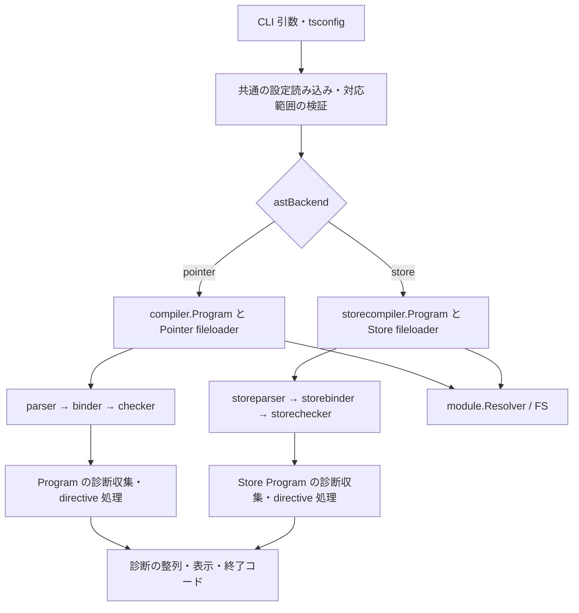

# Pointer と Store を CLI から比較する設計（7e）

作成日: 2026-10-04。設計対象は `/Volumes/SanDisk1TB/ghq/github.com/no-yan/TypeScript`、branch `store-ast`、HEAD `a16540cd8e828b53ad269130889bcf680debd2e4`。

## 1. 採用する構成

同じ `tsc` binary に実験用の `--astBackend pointer|store` を追加する。既定値は `pointer`。Store 用の `storecompiler.Program` を作り、実ファイルの探索、parse、bind、check、診断の出力まで接続する。Store 側は対象の TS/JS/JSON ソースや標準 lib の Pointer AST を構築しない。

設定読み込み、ファイルシステム、module resolver、診断の表示は既存実装を使う。AST に依存する Program と fileloader は Store 版を用意する。これにより、両側が実際の Program を通り、harness の問い合わせ記録や Pointer による先行 parse の費用を含まずに比較できる。

初版は単発の、単一スレッドの semantic check を対象とする。emit、宣言生成用の診断、incremental、watch、build、LSP/API、content mapper、project references は後段に分ける。初版の制限に当たる入力は理由付きで拒否する。Pointer への自動 fallback は行わない。

本書は提案段階であり、追加 flag、package、benchmark は未実装である。

| 決定事項 | 内容 |
| --- | --- |
| backend の選択 | CLI 専用 flag。環境変数による選択は追加しない |
| 初版の範囲 | 単発・単一スレッドの semantic check。単一スレッド限定は初版の設計上の選択 |
| 未対応入力 | 理由付きで拒否し、Pointer への fallback は行わない |
| 性能評価 | 必須の測定は §7、評価基準の候補と未決事項は §8.3。指示書の前に確定する |



## 2. 現状と接続点

| 現在の経路 | 確認したこと | 設計への影響 |
| --- | --- | --- |
| `cmd/tsc/main.go` → `execute.CommandLine` → `tscCompilation` | 引数と config を読んでから watch、incremental、通常の compile に分岐する | config が確定した後、これらの実行分岐の前で backend と対応範囲を決める |
| `execute.performCompilation` → `compiler.NewProgram` | `NewProgram` が `processAllProgramFiles` を呼び、Pointer AST を構築する | checker だけの差し替えでは目的を満たさない |
| `storeharness.newProgram` | Pointer の `SourceFiles()` を同じ text から Store に再 parse する | CLI の実行経路には使わない |
| `storeharness.Program` | module 解決や metadata を Pointer Program に委譲する | 正しさの比較対象として残す |
| `storeharness.FixtureProgram` | 記録済みの問い合わせを再生し、未記録の問い合わせは panic する。解決診断は記録時に落とす | 任意のプロジェクトを読む Program の代用にはならない |
| `diagnosticwriter.Diagnostic` / `FileLike` | 表示処理は既に AST 型を抽象化している | Store 用 wrapper を加え、plain/pretty/locale/summary を共有する |
| `tools/cmd/storetranslate` | compiler は現時点の変換対象にない | check に必要な宣言だけを変換対象に追加する |

根拠は [CLI](../../execute/tsc.go)、[Program](../../compiler/program.go)、[fileloader](../../compiler/fileloader.go)、[harness の構築](../../storeharness/program.go)、[adapter](../../storeharness/adapter.go)、[fixture](../../storeharness/fixture.go)、[診断表示](../../diagnosticwriter/diagnosticwriter.go)。

## 3. CLI の契約

対応するプロジェクトでは次の形で呼ぶ。同じ binary、cwd、config、引数を使い、backend だけを変える。

```sh
tsc --astBackend pointer --noEmit --singleThreaded --pretty false -p ./tsconfig.check.json
tsc --astBackend store   --noEmit --singleThreaded --pretty false -p ./tsconfig.check.json
```

`astBackend` はコンパイラの言語動作を変える設定ではなく、実行実装の選択である。CLI 専用の列挙値として `tsoptions` に登録し、既存の引数解析と response file の展開を通す。引数文字列を `main` で抜き取る別パーサーは作らない。tsconfig での指定は拒否する。不正な値、値の欠落も既存 CLI と同じ場所で診断する。

簡易 help では `ShowInSimplifiedHelpView=false` により非表示とする。`--all` では列挙値、既定値、実験用であること、Store の初版の制限を表示する。「help 非表示」を `--all` まで含む指定にはしない。

Store を選んだ場合の対応範囲は次のとおり。最終的にマージされた設定で判定し、config の `extends` 先も対象にする。

| 項目 | 初版の契約 |
| --- | --- |
| `-p`、通常の root file 指定、`extends`、include/exclude | 対応。既存の設定解析を共有 |
| TS、TSX、JS、JSX、`.d.ts`、`resolveJsonModule` | 対応。標準 lib、node_modules、types、triple-slash reference も探索 |
| module 解決 | NodeNext/Node16、bundler、paths/baseUrl、package exports/imports、symlink、package dedup を含める |
| `--noEmit` | 必須。JS、`.d.ts`、buildinfo を書かない |
| `--singleThreaded` | 明示的に必須。checker は 1 個。矛盾する `--checkers` 指定は拒否 |
| `declaration`、`emitDeclarationOnly`、`declarationMap`、`isolatedDeclarations`、`composite` | 有効なら初版では拒否。semantic check だけで処理済みとはしない |
| incremental、watch、`--build`、project references、content mapper | 初版では拒否。空の `references: []` は許可する。参照先の事前 build や Pointer 実行で補わない |
| `--noCheck`、`--listFilesOnly` | check 比較の誤用を避け、初版の Store check モードでは拒否 |
| `--listFiles`、plain/pretty、locale、quiet | 対応。listFiles は graph の照合にも利用 |
| `--diagnostics`、`--extendedDiagnostics`、`--pprofDir` | 対応。表示項目と計測区間は §7 に従う |
| `--explainFiles`、`--generateTrace` | 初版では拒否。include 診断の生成と explainFiles の表示は別の責務 |
| `--help`、`--version`、`--showConfig` | コンパイルを開始しない既存の動作を維持 |
| `--init` | backend 未指定・`pointer`・`store` のすべてで共通の config 生成を行い、`astBackend` は生成しない。check モードの制限は適用しない |

未対応の実行要求は `ExitStatusNotImplemented` と具体的な理由を返す案とする。不正な引数や config は既存の診断・終了コードに従う。`--build` は通常の config 分岐より早く処理され、`--lsp` と `--api` は `main` で分岐するため、それぞれでも Store 指定を黙って無視しないことを検証する。

`execute/tsc/init.go` の `generateTSConfig` は、現在 `init`、`help`、`watch` 以外の指定を出力候補にし、`IsCommandLineOnly` を参照しない。7e ではこの生成候補から `astBackend` を明示的に除外する。CLI 専用 flag 全体の整理は別変更とし、他の option の出力を同時に変えない。`--init` は引数の検証後、Store check 用の制限を検証する前に処理する。backend 未指定・`pointer`・`store` の生成内容が byte 一致し、既存 config parser で再読込できることを小さな CLI 試験で確かめる。

`tsoptions/showconfig.go` も出力から除外する option を列挙しているため、`--showConfig` の出力からも `astBackend` を除外する。引数エラー → init → version → help/all → config 読み込み → showConfig → Store check の対応範囲検証という既存の順序を維持する。

### 3.1 `--noEmit` が実行する仕事を揃える

現在の `compiler.GetDiagnosticsOfAnyProgram` は、`--noEmit` でも宣言出力が有効なら `GetDeclarationDiagnostics` を呼ぶ。さらに `composite` は `IsIncremental()` を有効にする。したがって、Store 側だけ宣言診断や incremental を省く比較は成立しない。

既存の `testdata/fixtures/compiler/tsconfig.json` は `tsconfig-base.json` から `composite`、`declaration`、`declarationMap`、`emitDeclarationOnly`、`isolatedDeclarations` を継承する。初版の比較用 config では、これらと `incremental` を両側で明示的に無効にし、`noEmit` と `singleThreaded` を有効にする。root、include、module、target、strict、lib、skipLibCheck は元の設定を維持する。派生 config は元 config と同じディレクトリに置くなど、相対パスの解釈を変えない。

この入力は「compiler プロジェクトの semantic check」と呼ぶ。元の build や宣言診断を含む完全な `--noEmit` の性能とは区別する。VS Code 規模の入力でも同じ原則を適用し、解決後の file 集合と設定の差を保存する。project references を削って入力を小さくした結果を元プロジェクト全体の結果として扱わない。代表入力に未対応機能が不可欠なら、その対応を完了するまで当該入力の比較完了とはしない。

## 4. Store 用 Program と fileloader

### 4.1 所有するデータ

新設する `internal/storecompiler` が `storechecker.Program` を実装する。Program が所有するものは、1 個の `IDSpace`、Store の source files、path ごとの file 表、source metadata、module/type resolution cache、include reasons と診断、synthetic imports、単一 checker とその診断 cache である。

`SourceFiles()` の順序は既存 fileloader の順序に合わせ、StoreID と独立に保持する。並びを単純な path sort に置き換えない。既存のモジュール探索、global symbol の取り込み、診断に影響する可能性があるためである。

Store 用 Host は FS、cwd、default lib path、設定 cache、trace を受け取り、`GetSourceFile` で Store parser を呼ぶ。`compiler.CompilerHost.GetSourceFile` は戻り値が `*ast.SourceFile` なので、その埋め込みだけで流用しない。`module.Resolver` は `ResolutionHost` と文字列・mode で動くため共用する。共通 FS cache は両 backend で同じ寿命に揃える。

設定解析で使う `tsoptions.ParsedCommandLine`、tsconfig の JSON AST、package.json の情報は既存型を保持してよい。対象ソースと lib の Pointer AST を作らない契約とは区別する。`resolveJsonModule` でプログラムに入る JSON は対象ソースなので Store parser で読む。

### 4.2 ファイル探索と解決

移植範囲は `compiler/fileloader.go`、`filesparser.go`、`fileInclude.go`、`includeprocessor.go`、`processingDiagnostic.go` の check に到達する部分とする。

必要な処理は root/default lib/types の読み込み、imports と module augmentations、triple-slash の path/type/lib references、JS の探索制限、解決 mode、package/casing/symlink の処理である。`processedFiles` に相当する Store の結果を返す。ファイルを読み込めなかった理由や resolution diagnostics を捨てない。

`module.Resolver` の結果を使って Store file を読み込み、Store AST から module specifier を取得する。既存の `storemodule.GetResolutionDiagnostic` を利用する。`storeharness/mode.go` のノード依存の mode 判定は、本番側の関数を正本にして harness が呼ぶ形へ移す。

JSX runtime と import helpers の specifier は `store.NewSyntheticImport` で作る。同じ file・同じ役割には同じ Node を返す。作成条件、順序、親、file 所属を Pointer と揃える。これらのノードは file の Statements には入れない。

### 4.3 動的に StoreID を割り当てる

7e は親設計の Y3 と不変条件22を変更する。従来の「source は `0..nFiles-1`」と、CLI で読み込み後にその範囲へ振り直す方針を、source を含む動的な単調採番へ置き換える。実際の CLI では import を読んでからファイル数が増える。さらに探索中に合成 import が作られるため、後からの再採番には既存の合成 Store と発行済み `NodeKey` の無効化・更新、または公開の延期を管理する制約が要る。採番を一度にすることで、その制約を持ち込まずに済む。Pointer で先にファイル数を数える方法も採らない。

動的 Program は `NewIDSpace(0)` で開始し、source、eager/lazy JSDoc、synthetic import、checker/printer の Store を同じ単調な allocator で採番する。source 用の ID も `Next()` から取得することを正式な契約にする。source の生成入口にこの採番を閉じ込め、caller が探索 index を StoreID として渡さない。

`IDSpace` の API 契約を次のように区別する。

| 構築方式 | source の ID | それ以外の Store の ID | 適用範囲 |
| --- | --- | --- | --- |
| `NewIDSpace(0)` | parse の前に `Next()` で取得 | 同じ `Next()` で取得 | native Program。探索途中で source が増える |
| `NewIDSpace(nFiles)`、`nFiles > 0` | 予約済みの `0..nFiles-1` を重複なく一度だけ割り当てる | `nFiles` から始まる `Next()` で取得 | 全 source 集合が既知の fixture/H1 と既存試験。予約後に source を追加しない |

`Next()` は未予約の新しい Store 全般に使える API とし、source 以外に限定しない。`ParseSourceFileIn` と source Builder は、同じ IDSpace から取得した未使用 ID、または固定予約内の未使用 ID を受け取る。固定予約の境界は型判定には使わない。空 fixture は `NewIDSpace(0)` として扱えるが、native Program を途中で固定予約方式へ変更しない。

StoreID の再利用、後からの振り直しはしない。`SourceFiles()[StoreID]`、`StoreID < sourceCount` による種類判定、source ID の連続性に依存するコード、links の page 表、試験を監査する。親設計の Y3・不変条件22、動作設計、`IDSpace`・StoreID・parser の API コメントもこの契約に揃える。

受入試験は `source A → lazy JSDoc A → 合成 import A → source B → lazy JSDoc B → 合成 import B → source C` の順で Store を増やす。各段で取得した ID と `NodeKey` を保存し、最後まで非衝突・不変であること、foreign 辺と links が同じノードを指すことを確かめる。source 内で eager JSDoc を持つ parse も含め、別 Store を作る場合だけ新しい StoreID を消費することを確認する。通常 tag と `storechecks` の両方で実行する。現在の `Next()` は原子的だが、それだけで loader や checker の並列実行を保証するものではない。

### 4.4 bind と checker の寿命

graph が確定してから全 source を bind する。既存 `storebinder.BindSourceFile` の once と seal の規約を使い、checker 作成時の bind 要求は既に済んだ仕事になる。Program が単一 checker を保持し、global/semantic diagnostics の問い合わせ間で使い回す。ファイルごとに checker を作らない。

Program ごとに IDSpace を分離する。Store の lib AST を別 Program に持ち越さない。共有可能な cache は file text など AST 以外に限定し、Pointer 側と条件を揃える。checker の mutable region は checker 専有とする。診断や serializedTypes が参照する合成 node を、出力前に release・ゼロ埋め・再利用しない。

並列版では Pointer と同じ checker 数、file association、bind 方針で測る必要がある。これは初版の完了条件から分離する。単一スレッドの結果を既定の並列 CLI の結果とは呼ばない。

## 5. 診断を既存 CLI と揃える

Store の実行は、対応範囲内で `compiler.GetDiagnosticsOfAnyProgram` と同じ収集順序と短絡条件を持つ。config 診断、syntax 診断、program/options/include 診断、bind、global、semantic、check 後の global を扱う。構文エラー等で既存 CLI が check を省く場合、Store も同じように省く。config 診断の個数を基準にする既存条件も維持する。

ファイル単位では `SkipTypeChecking`、skipLibCheck、skipDefaultLibCheck、checkJs/ts-check、plain JS の診断制限、JSDoc 診断、`@ts-ignore`、`@ts-expect-error` の未使用診断、`SkippedOnNoEmit`、include 診断を移植する。bind 診断を先に全部出力すると directive 処理や skip 条件を破るため、既存と同じ semantic 集計で扱う。suggestion と type/symbol walk は通常の CLI の仕事に含めない。

Store parser と binder は file が nil の `*ast.Diagnostic` を持ち、checker は `*store.Diagnostic` を返す。Program の取り込み口で前者を Store file に結び付ける。message key/args、text、chain、related information、category、source、unnecessary/deprecated、SkippedOnNoEmit、repopulate 情報を失わない。表示のために対象ソースを Pointer で再 parse しない。

表示境界では `diagnosticwriter.Diagnostic` を使う。ただし、この interface だけには raw message identity や args がないため、表示 wrapper に変換して文字列順で sort する実装は不可とする。最終集計には、元の AST 診断または Store 診断と file override を保持する内部の診断 view を設ける。config の Pointer 診断と source の Store 診断をこの view で混在させ、元の field を読んで整列する。

比較順序は `ast.CompareDiagnostics` と同じ path、位置、code、category、source、message identity/args、chain、related information とする。`compiler.SortAndDeduplicateDiagnostics` と同様、related information だけが違う重複を統合する。これらの規則は共通 helper または既存変換器で管理し、独立した手書きの比較規則を増やさない。混在診断での順序・統合を試験する。Store のために既存 `ProgramLike` へ偽の Pointer source file を返させない。

### 5.1 execute の共有契約

`performStoreCheck` は Store Program を構築し、次の狭い契約に適合させる入口とする。同じ対応範囲の Pointer one-shot check もこの契約を通す。execute の `CollectCheckDiagnostics` が収集順序と短絡条件を、`ReportCompilation` が報告順序と終了コードを所有する。以下は追加する API の形であり、既存 API ではない。

```go
// execute/tsc に置く。各 callback は Program 全体の同じ対象順を使う。
type CheckStages struct {
	Config    func() []DiagnosticView
	Syntactic func(context.Context) []DiagnosticView
	Program   func() []DiagnosticView
	Bind      func(context.Context)
	Global    func(context.Context) []DiagnosticView
	Semantic  func(context.Context) []DiagnosticView
}

type CompilationReport struct {
	Diagnostics   []DiagnosticView
	FileNames     []string // Program 順。AST や Program は渡さない。
	EmittedFiles  []string // 初版の noEmit は空。
	Statistics    func() ProgramStatistics // 要求時だけ値を取得する。
	Times         CompileTimes
	EmitSkipped   bool // 既存 EmitResult と同じ意味。無出力とは区別する。
	EarlyExit     *ExitStatus // 非 nil は引数/config/未対応等で決定済みの status。
	CheckExecuted bool // 計測の成立判定に使う。status の代用ではない。
}
```

`DiagnosticView` は前述の比較用 view である。`ProgramStatistics` は files/lines/identifiers/symbols/types/instantiations を持つ値だけの struct とし、両 Program の adapter が同じ定義で集計する。reporter はこれに既存 `System`、writer、locale と表示 options を受け取り、AST 型や Program 型には依存しない。Program と checker の所有者は reporter が終わるまで両者を生存させる。statistics 用 GC を実行する場合は、その後まで明示的に保持する。

`CollectCheckDiagnostics(ctx, stages)` の規則は次のとおり。初版は declaration、listFilesOnly、content mapper を事前に除外した経路にだけ適用する。

1. config 診断を取得し、その個数を基準値にする。syntax 診断を加える。
2. syntax 診断が増えていなければ program 診断を加え、bind を実行する。bind の戻り診断はここでは追加せず、Semantic が directive/skip を適用して返す。
3. 手順2と同じく syntax 診断が増えていない場合に限り、global 診断を取得する。ここまでの個数が基準値と同じ場合だけ Semantic を呼び、続けて Global をもう一度呼ぶ。syntax 診断があれば Program/Bind/Global/Semantic のすべてを省く。
4. stage の実行有無と時間を記録し、共通の比較規則で整列・重複統合する。構文エラー等による check 省略を計測上の 0 ns としない。

Store と Pointer の adapter は各 callback の値を返すだけにし、この分岐を持たない。既存 `GetDiagnosticsOfAnyProgram` の同じ部分から規則を抽出し、従来経路との characterization test を先に置く。emit/declaration/incremental 等の対象外経路を、この限定 collector に押し込まない。

`ReportCompilation` は次の順序を一か所で実装する。

1. 診断の個別表示。quiet、plain/pretty、locale の既存規則を使う。
2. `listFiles` と、該当時の emitted file 名の表示。
3. error summary。現実装では pretty に従い、quiet は個別診断だけを抑止する。quiet を全 writer の破棄に置き換えない。
4. total time を確定する。statistics が有効なら既存と同じ 2 回の GC と runtime memory 値を取得し、その後で `Statistics()` を呼び、Times と組み合わせて既存の表を表示する。
5. `EarlyExit` があればその値を維持する。通常の完了は診断がなければ 0、診断があり `EmitSkipped` なら 1、その他は 2 とする。

早期終了は専用の report 分岐とし、現 CLI が出さない listFiles/summary/statistics を追加しない。現在の通常 one-shot `--noEmit` は `HandleNoEmitOptions` が空の `EmitResult` を返し、`EmitSkipped=false` なので、診断ありの終了コードは 2 である。ファイルを書かないことを理由に 1 に変更しない。Store でも同じ noEmit 結果を値として返す。

既存の symbol/type/instantiation 集計は checker を遅延生成し得る。`Statistics()` は statistics 指定時だけ、既存と同じ GC・memory snapshot の後で呼ぶ。syntax error の後に統計取得が bind/checker 初期化を起こす場合も両側で揃え、その実行は semantic stage の `CheckExecuted` と分ける。`Memory allocs` はプロセス累積の `MemStats.Mallocs`、`Memory used` は取得時の `Alloc` のままとし、区間の `allocs/op` や retained 測定へ読み替えない。

既存 `EmitInput.Program`、大きな `ProgramLike`、incremental 向け `CommandLineTesting.OnProgram` を Store に実装させない。listFiles/statistics の既存テスト hook は報告側に残し、Store の試験は CLI 出力・exit status と Store Program を直接観測する。共有先は表示 helper だけでなく、collector、reporter、終了コード規則まで含む。

成功は既存と同じ終了コード 0、対応済み入力のコンパイル診断は既存 noEmit と同じコードと出力を返す。早期の config エラー等も既存の終了コードをそのまま照合する。panic を空の診断へ変換して成功扱いにしない。

## 6. 生成コードの境界

`tools/cmd/storetranslate/pkgs.go` に Store compiler 用の対象を追加し、roots として check に必要な Program/loader/診断関数を列挙する。`modeFull` で compiler の全 type と emit の依存まで一括変換する案は採らない。

Program/Host、dynamic IDSpace、診断の取り込み、単一 checker の所有は手書きの境界とする。探索規則や AST を読む診断規則は可能な範囲を型に基づいて変換する。例外は既存の `*_manual.go` と `pointer-hash` に従う。生成ファイルを直接直さない。共通 module resolver、tsoptions、core のノード非依存処理は元 package を使う。

現在の変換器は到達した interface の全 method へ展開するため、既存 `compiler.ProgramLike` を root にすると `Emit` や `GetDeclarationDiagnostics` まで広がる。Store の check に必要な狭い入口を root とし、生成器の到達一覧も受入の証拠に残す。

最初の実装単位で、最小 root file と import 1 本が動くまでの生成対象を確認する。現在の変換器が compiler の混在型をそのまま処理できるとは未検証である。tsconfig の `*ast.SourceFile` と対象ソースを区別できない変換箇所、emit/transformer へ到達する箇所を列挙し、手書き境界か小さな宣言の分離で切る。この確認前に compiler 全体の generic 化や全面移植を始めない。

## 7. パフォーマンス比較の契約

### 7.1 既存 artifact の扱い

再測定の前に既存 artifact を確認する。状態は `current`、`stale`、`missing`、`unsupported` を用いる。`current` は `repo_root` と、計測 binary にコードを含む各 repository の git rev が選択 checkout に一致した場合だけに使う。dirty diff、overlay、binary hash、入力も別途記録する。binary が同一でも別 rev の計測を `current` に付け替えない。

artifact があり、その `bench.txt` に要求 regex の `Benchmark...` 行がない場合、その stage は `unsupported` とする。構文エラーや global error で check に入らなかった CLI 実行も、Check の 0 ns というサンプルにしない。

過去の数値、raw の出所、artifact ごとの状態、再集計条件は付録Aにまとめる。native CLI の測定値は `missing` であり、旧 checker 区間の結果をその代わりには使わない。

### 7.2 測る仕事と指標

| 測定 | 区間・方法 | 指標 |
| --- | --- | --- |
| CLI end-to-end | 同一 binary の独立した子プロセス。引数/config 読み込みから診断表示と終了まで。通常 GC。profile と statistics 表示なし | wall time、CPU time、peak RSS。macOS では必要に応じ footprint も記録 |
| native Check KPC（必須） | 両 native Program を事前に構築・bind。GC オフ・単一スレッドで `NewChecker`、対象 file の `GetDiagnostics`、`GetGlobalDiagnostics` のみを測る | cycles/op、inst/op、IPC、ns/op、B/op、allocs/op。従来 Check と同じ仕事の比 |
| 共通実行入口の反復 | benchmark から同じ `execute.CommandLine` を新しい System/FS cache/Program で呼ぶ。output writer も同じ条件。lib AST cache を片側だけ温めない | `ns/op`、`B/op`、`allocs/op`。プロセス起動を含まない値として別名で報告 |
| Program 構築 | config 確定から graph 確定まで。ファイル I/O、parse、module 解決、include を含む | 時間、割り当て、必要に応じ inst/cycles。単なる parser 単体とは呼ばない |
| Program 経由の Bind / Check | 全 file の bind と、その後の checker 初期化・global/semantic 診断を区分。Program の skip/directive/filter と execute の収集を含める | 時間、割り当て。Check の作成/初期化を timer の外に逃がさない |
| 診断後処理・表示 | directive/filter、sort/dedup、writer をどの区間に計上したか記録 | 時間、割り当て。診断の多い入力で別途評価 |
| retained / GC | 独立した測定プロセスで Program と checker を保持し、parse、bound、checked の同じ地点を観測 | HeapAlloc、scan bytes、mark CPU、GC 回数。強制 GC と lifetime の条件を保存 |

`--diagnostics` は現在、表示前に GC を 2 回実行する。Store の statistics も同じ意味に揃えるが、その実行を通常の CLI wall time の基準には使わない。既存 `--pprofDir` の memory profile は `allocs` なので、それを retained の測定値と呼ばない。profile、KPC、強制 GC は通常 GC の無計装 timing と別実行にする。

既存の表示にある Parse time は Program 構築の時間であり、純粋な parser 時間ではない。options/global diagnostics による checker 初期化もあるため、既存 Check time 表示だけを完全な checker 費用と見なさない。詳細計測では `config`、`program`、`bind`、`check`、`report` の境界を両側で揃え、未計上の処理を残さない。プロセス開始からの wall time を最終結果として併記する。

子プロセスを起動する Go benchmark の親側 B/op は compiler の B/op ではない。CLI の子と、割り当てを測る同一プロセスの benchmark は区別する。fresh process と反復内の pool 再利用で cache 状態も異なるため、両者の値を同じ列に混ぜない。

### 7.2.1 adapter を介さない Check KPC

TODO 9 の Check 比を得るため、`BenchmarkNativeCheckKPC` を必須成果とする。比較する仕事は `storeharness/measure_test.go` の `checkPointer` / `checkStore` と同じである。Store は `storecompiler.Program`、Pointer は `compiler.Program` を使う。H1、FixtureProgram、記録済みの module 解決を計測経路に持ち込まない。

計測前の等価試験で、同じ FS・roots・設定から両 Program をそれぞれ独立に構築し、graph と対象 file の path・順序を照合して manifest に保存する。計測の各子プロセスは選択した backend の Program だけを構築し、Store の子に Pointer Program を保持しない。旧 Check と同じ対象選択を使い、`SkipDefaultLibCheck` で default lib を除く条件を揃える。CLI の skip 条件によって対象をさらに変えた区間とは別名にする。片側の file 配列を相手の構築に使わない。

測定境界を固定する。

- 区間外は config、Program 構築、I/O、parse、module 解決、全 source の bind、対象 file の選択と照合。setup で Program の global/semantic 診断を問い合わせず、checker を先に生成しない。
- 区間内は `checker.NewChecker` または `storechecker.NewChecker` を 1 回、対象順の `GetDiagnostics`、最後の `GetGlobalDiagnostics`。`NewChecker` 内の bind 済み判定も区間内の仕事に含める。
- Program の診断後処理、suggestion、type/symbol walk、sort/dedup、表示はこの区間に含めない。診断値の消費と期待結果の照合は計測の外で行う。
- 各サンプルは新しい Program と新しい checker を使う。resolution cache は同じ構築手順の完了状態、checker の cache は未初期化から開始する。lib AST、lazy JSDoc、直前の check 結果を片側だけ再利用しない。

GC オフの KPC session、singleThreaded、checker 1 個、同じ binary/build 条件で実行する。準備・cleanup と counter の有効区間を raw に記録する。GC を止めた長い反復で確保を積み上げず、初期手順は `-benchtime=1x` 相当のサンプルを独立した子プロセスで取得する。必要な GC やプロセス終了は区間外で行う。

Pointer と Store の順序を交互に入れ替え、warm-up、同一 binary・同一 backend の A/A、両 native Program の A/B を保存する。`bench.txt`、benchstat、A/A の raw と幅、環境、対象 path/順序、cache 条件を artifact に残す。旧 artifact は `stale` の参考値とし、native 比そのものは同じ rev の両側から計算する。

この Check KPC、Program の後処理を含む測定、通常 GC の CLI end-to-end はそれぞれ別の結果として必ず報告する。KPC の ns/op を通常 GC の wall time と同一視しない。KPC を実行できない環境ではその成果を未取得とし、CLI timing で代替して測定完了とはしない。

### 7.3 入力、順序、保存形式

最初の入力は compiler fixture の両側共通の semantic-check config とする。次に VS Code 規模の実入力、さらに診断の出る TS/JS/JSX と declaration-heavy な入力を含める。VS Code の checkout、依存物、使用 config は未決であり、§8.3 の評価基準とともに指示書作成前に固定する。node 数だけを合わせた合成入力を実 workload の代用にしない。

backend は別プロセスで交互に実行し、順序を入れ替える。通常 GC、GOMAXPROCS、singleThreaded、checker 数、Go version/build tags、lib、依存 lockfile、cwd、OS file cache の条件を揃える。warm-up は明記して集計から分ける。初期値は各 10 標本とし、揺れと目的に応じて標本数を決める。過去の負荷条件は参考にし、現在の環境で A/A の幅を記録する。

artifact set は `metadata.json`、`pointer/bench.txt`、`store/bench.txt`、`benchstat.txt`、CLI の stdout/stderr/exit status、入力 manifest、任意の profile から成る。metadata に `repo_root`、git rev、dirty diff/overlay hash、binary hash、実行コマンド、環境、backend、checked file 数を保存する。実際に binary のコードを提供する repository だけを列挙する。入力側の repository と依存物の rev/hash は別項目で保存する。

同じ workload・同じ測定区間の raw 出力だけを `benchstat old.txt new.txt` に渡す。backend 部分だけを正規化し、正規化前の名前を保持する。before/after でも同様に raw を残す。仕事や設定が異なり比較できない場合は、その理由を報告して ratio を出さない。

## 8. 正しさと完了条件

### 8.1 機能の受入

機能としての完了、性能の評価、Store の既定採用を分ける。機能の完了は、対応入力で両 CLI が同じ結果を返し、費用を混ぜずに比較を実行できることである。7e 全体の完了報告には、§7 の必須測定と、事前に決定した §8.3 の基準による性能評価も必要とする。Store を既定値に変える判断は別である。

必要な証拠は次のとおり。

1. backend 未指定と `pointer` 指定で既存 CLI の診断、終了コード、出力ファイルが一致する。Pointer 実行では Store Program、IDSpace、checker を構築しない。同一 binary へのリンクで増える package 初期化や静的メモリは、結線前後の Pointer 比較で別途確認する。
2. 対応入力について roots、SourceFiles の順序、default lib、metadata、resolved modules/types、synthetic imports が一致する。循環 import、NodeNext/bundler、JSX、JSON、types、symlink、未解決参照を含める。
3. plain と pretty の診断全文、path/span/code/category、chain/related information、sort/dedup、終了コードが一致する。syntax/global error の短絡、empty program、plain JS/JSDoc、directive、skip 設定を検証する。
4. §4.3 の source・JSDoc・合成 import が交互に増える操作列で、ID と発行済み NodeKey の非衝突・不変、foreign 辺と links の同一性を確認する。異なる Program の node を拒否する。固定予約 fixture の互換性も通常 tag と `storechecks` で確認する。
5. Store 本番経路は storeharness、Fixture、Pointer Program を呼ばない。呼出経路の監査と source path を識別する計数試験を併用し、対象ソース/lib の Pointer parse/bind/check が 0 回であることを確認する。config JSON の parse は別集計にする。profile に frame がないことだけを証拠にしない。
6. 対応外の設定は、source の parse や Pointer fallback を始めず拒否する。`.tsbuildinfo` を含む書き込みがない。未対応の条件で `nil` や空の結果を返して診断を消さない。
7. §8.2 の段2由来の全対応構成と CLI 専用 fixture で独立構築した Program を比較し、manifest に全母集団の内訳を残す。Pointer の graph を借りる既存 harness の成功を native loader の証拠に代えない。
8. 生成器の再実行で差分がない。compiler の元宣言変更を hash 検査が検出する。生成結果が不要な emit/incremental/LS を呼んでいない。
9. compiler と大規模実入力の通常 GC end-to-end、Program 経由の測定、共通実行入口の ns/op・B/op・allocs/op、profile の hot paths/allocation drivers、retained/GC を取得する。加えて §7.2.1 の native Check KPC、raw・benchstat・A/A を必須成果として保存する。未対応入力と check 未実行を成功サンプルに含めない。
10. 小さな CLI 試験で §3 の引数・response file・config・help/init/showConfig、§5.1 の出力順・quiet/pretty・summary・statistics・終了コード、check モードの書き込み禁止を確認する。

### 8.2 等価試験の母集団と CLI 境界

母集団は段2の `tests/cases/compiler` と `tests/cases/conformance` の `.ts/.tsx` 全 file と option variations とする。`storeharness/configprep_test.go` の列挙と入力分解を再利用し、case/variation ID を維持する。過去の equal 13,446 構成は履歴値であり、native CLI の対応件数や合格件数ではない。

新しい比較 runner は raw file bytes、symlink、cwd、case sensitivity、roots、config/options からなる入力記述を作り、同じ記述から fresh FS・Host・Program を両側で独立に構築する。共有してよいのは入力値だけとする。Pointer の SourceFiles、module 解決結果、metadata、diagnostic targets は Store に渡さない。各側が自分の graph から対象を選び、graph と Program の後処理済み最終診断を比較する。既存の checker 生出力比較は別試験として維持する。

段2の準備では `SkipDefaultLibCheck`、`NoErrorTruncation` 等を補っているため、補正後の実効設定も manifest に記録する。native check 群には両側共通の実行条件 `noEmit=true`、`singleThreaded=true` を追加し、元 case ID に対応する派生 ID と設定差分を保存する。これ以外は §3 の対応条件を各構成に適用し、declaration/composite 等を黙って無効化して同じ case の合格にしない。§3.1 のような追加の設定変更を用いる入力も別 ID と変更差分を持たせる。

manifest は少なくとも次を持つ。

| 項目 | 保存する値 |
| --- | --- |
| 入力の同一性 | suite、caseId、variation、source/input tree hash、lib hash、cwd、case sensitivity、symlink、roots/argv、config、実効 options |
| 母集団と選択 | 全列挙数、入力エラー、filter/sample/shard による非選択、選択理由。最終受入では対応構成を全量実行 |
| 対応判定 | legacy runner の結果/除外理由と、native の対応/非対応理由を別 field にする。必要機能、非対応 option、専用 fixture の補完先 ID |
| 各側の結果 | build、graph、最終診断の結果、exit code、source/checked file 数、短絡理由、write 記録、stdout/stderr、差分の最初の位置 |

legacy skip、native 非対応、非選択、入力エラー、Pointer の panic は equal 件数に含めない。両側の同じ panic も等価成功にしない。対応機能の未実行や差分があれば受入未完了とし、除外規則を追加して消さない。全母集団が manifest のいずれかに入り、対応構成数と実行・合格数が一致することを検査する。

旧 runner の `SkipUnsupportedCompilerOptions` は `baseUrl` などを除外するため、corpus を通すだけでは §3 の範囲を覆えない。raw tsconfig と CLI 引数から実行する専用 fixture を追加し、両側に期待する file/path/診断も固定する。

| 専用 fixture 群 | 必須の分岐 |
| --- | --- |
| 解決と探索 | baseUrl+paths、NodeNext の import/require、bundler、exports/imports、types/lib/path reference、JSX runtime、importHelpers、JSON、循環、symlink/casing、package dedup |
| 欠落と診断 | root/import/type/lib の欠落、構文エラー、global error、semantic error、directive と unused expect-error、skipLibCheck/skipDefaultLibCheck、plain JS/JSDoc、empty roots |
| CLI 入口 | argv と response file の backend 指定、不正値・値欠落、`-p`、extends、tsconfig 内の astBackend 拒否、help と `--all`、version、init、showConfig |
| 報告と副作用 | plain/pretty × quiet、listFiles、summary、statistics の順序・副作用・終了コード。check 時に JS/d.ts/buildinfo を書かない。未対応の拒否では source parse/check/write が 0 |

`--init` の config 生成と、明示された profile 出力は check の生成物禁止とは別の許可された出力として扱う。`--init` は backend 未指定・pointer・store の生成 byte 一致と再読込、`--showConfig` は backend 非混入を確かめる。

### 8.3 性能の評価基準は指示書の前に決定する

未決なのは、代表入力の確定、各入力で許容する wall time・retained memory・GC 費用の退行、native Check KPC の線、測定誤差が残る場合の扱いである。これは性能の受入条件を不要とする意味ではない。以下は選択のための候補であり、まだ受入基準ではない。

| 未決項目 | 候補 |
| --- | --- |
| 代表入力 | compiler の semantic-check config、rev/依存/config を固定した VS Code 規模の実入力、declaration-heavy 入力、診断のある TS/JS/JSX。採用する入力と重視する指標を先に固定 |
| 候補A・時間回帰を小さく保つ | 各主要入力の Store/Pointer wall time 上限 1.02、retained と GC mark CPU の上限 1.00。どの入力でどの費用削減を期待するか別記 |
| 候補B・メモリ削減との交換を認める | 大規模入力で wall time 上限 1.05 を許容する代わりに、retained 上限 0.85、GC mark CPU 上限 0.80。小さい入力の回帰と peak memory も別途評価 |
| native Check KPC | compiler の同じ仕事について過去の cycles 比 1.10 を継続候補にする。native Program へ替えた測定条件の差を確認して採否を決める。CLI wall time の線とは別 |
| Pointer の結線前後 | 変更で増えた起動・reporting 費用を同条件の A/A と比較し、許容上限を入力別に決める。Store の利益で Pointer の回帰を相殺しない |
| 未確定結果 | ratio の区間が許容上限をまたぐ場合は未確定。追加の交互測定・A/A による解消、または残る不確実性と絶対時間/bytes を示した条件付き評価のどちらを認めるか先に決める |

候補の数値は今回の実測から導いた値ではない。候補A/Bをそのまま採る必要はなく、代表入力の目的に応じた組合せや別の上限も選べる。判定に使う推定値・信頼区間・A/A の許容幅、再測定の上限も指示書作成前に固定し、結果を見てから線を動かさない。GC 費用は通常 GC の実行と同条件の強制 GC mark CPU を分け、どちらを gate とするか明記する。

機能合格でも測定やこの決定が残る場合は「機能完了、性能評価未完了」と報告する。性能評価の結果は合格・未確定・退行を区別し、未確定を合格扱いにしない。7e 全体の受入は決定済みの基準に従う。Store の既定採用はさらに対応範囲と運用上の tradeoff を確認する別の判断とする。

性能に一律 3% の採用線は置かない。正しさ、再現する実入力の費用、実装と保守のコストで判断する。既存 Pointer の回帰を調べるため、結線前後の Pointer も benchstat で比較する。今回の Store 専用の分岐以外で Pointer に変化がある場合は、その帰属を説明する。

結果は「改善を確認」「差は未確定」「退行を確認」に分ける。有意差がないことを同等の証明にしない。割り当てや命令数の再現する削減は、wall time が未確定でも別に残す。過去の Check cycles、retained、mark CPU の線は過去の workload と測定契約に属し、CLI end-to-end の数値へそのまま移さない。

## 9. 実装を分ける単位

実装単位と、その依存関係を次に示す。

| 単位 | 変更範囲 | その単位を確かめる証拠 |
| --- | --- | --- |
| A. 生成境界と dynamic IDSpace | storetranslate の対象/roots、Store source 採番、Program/Host の最小構築 | import 1 本の native graph、ID 衝突・別 Program 拒否、生成再現性 |
| B. Store native loader | Store の fileloader、filesparser、include/解決処理 | 実際の FS/config を使う graph 等価、欠落ファイルの診断、Pointer source parse 0 |
| C. Program の check と診断 | checker 所有、skip/directive/filter、診断 view、整列・表示 | エラーあり/なしの CLI 相当出力、短絡と退出、通常 tag と storechecks |
| D. CLI 接続 | astBackend 解析、分岐、対応範囲、Store check result/statistics | 2 本の CLI コマンド、default Pointer 回帰、未対応の拒否、書き込みなし |
| E. 実 workload の比較 | native Check KPC、共通入口 benchmark、子プロセス runner、artifact metadata | Check KPC の raw/benchstat/A/A、Program 後処理込みの値、通常 GC の E2E、profile、retained/GC、設定と対象 file の一致 |

A → B → C → D → E の順とする。CLI の flag だけを公開した段階や、fixture を再生できた段階を完了にしない。B と C の実装は既存 Store parser/binder/checker の変更を必要最小限にし、loader の接続と微小最適化を同じ差分に混ぜない。

後段は、代表入力が要求する機能を優先する。project references と宣言診断、その後に同じ checker 分配を持つ並列版を検討する。emit、incremental、watch、LSP/API まで一度に広げない。

## 10. 選択肢と残る確認

| 案 | 利点 | 採否 |
| --- | --- | --- |
| harness を CLI から呼ぶ | 接続自体は短い | 不採用。Pointer の準備や fixture の録音費用が混ざり、本来の Program の費用を比べられない |
| checker だけを切り替える | 現 CLI の大半を流用できる | 不採用。source file の型と fileloader が Pointer に固定されている |
| Program/loader 全体を generic 化 | 長期的には規則の重複を減らせる | 初版では不採用。基準となる Pointer 経路にも広い変更が入る |
| Store compiler の必要範囲を生成・移植 | 既存 Pointer と比較しやすく、既存の変換規約も使える | 採用案。生成対象の増加と追従コストを明示管理する |
| `performStoreCheck` と狭い execute 契約 | Store 構築を分離し、報告・終了コードと収集制御を共有できる | §5.1 の採用案。入口を分けること自体は欠陥ではない。広い interface 案との実装差分量は、境界確認まで未検証 |
| 別 binary を作る | backend 固有の dependency を分けやすい | 初版では不採用。同じ binary の実行時選択で build 条件を揃える |

未検証なのは compiler 宣言の変換可能範囲、dynamic source ID に残る添字前提、大規模実入力が初版の対応範囲に収まるか、CLI 結線後の時間・メモリである。A の小さな接続で最初の 2 点を確認し、代表入力の設定監査で 3 点目を決める。最後は E の測定で判断する。

## 11. 関連する設計と証拠

- [checker 設計 §4 の 7e](store-checker-design-20260923.md)
- [Store 全体の設計](store-ast-design-20260922.md)
- [7d-2d 実装報告](store-checker-7d2d-implementation-report-20261003.md)
- [7d-2c 検証報告](store-checker-7d2c-verification-report-20261002.md)
- [旧 xctrace 帰属](store-checker-7d2c-xctrace-report-20261002.md)
- [StoreID](../store/idspace.go)、[Store File](../store/file.go)、[Store binder の診断](../store/bound.go)
- [既存 benchmark の測定区間](../../storeharness/measure_test.go)
- [CLI の emit/report 境界](../../execute/tsc/emit.go)、[statistics](../../execute/tsc/statistics.go)
- [変換対象の定義](../../../../tools/cmd/storetranslate/pkgs.go)

## 付録A. 過去の計測値と artifact の出所

| artifact set / 仕事 | 状態 | 利用できる範囲 |
| --- | --- | --- |
| `_store-checker-7d2d/kpc.txt` の after、Check 5 回ずつ | `stale` | 旧 tree `9a0f025bc4` + A の差分での checker 区間。選択 HEAD の native CLI 計測ではない |
| `_store-checker-7d2d-results/` | Check 計測の一次データとしては `missing` | 開始 HEAD は今回と同じだが、KPC は既存 binary と入力の一致を理由に省略した記録。新しい CLI 経路のデータではない |
| Pointer と Store の実ファイル CLI end-to-end | `missing` | 接続後に取得する |
| `_store-checker-7d2c-xctrace/` と 7d-2c の profile/報告 | `stale` | 過去の帰属と設計上の注意。後続修正済みの費用を現在の bottleneck と扱わない |

旧 Check の after 5 回から、discard と before を除いて raw 行を抽出した。backend の benchmark 名だけを揃え、`benchstat pointer.txt store.txt` で比較した。以下はその中央値であり、GC を止める KPC session の参考値である。

| backend | ns/op | B/op | allocs/op |
| --- | ---: | ---: | ---: |
| Pointer | 816,251,082 | 209,437,896 | 1,433,498 |
| Store | 860,867,834 | 225,120,824 | 1,569,732 |

benchstat の差は ns/op +5.47%、B/op +7.49%、allocs/op +9.50%、各 p=0.008、n=5。95% 信頼区間には標本数不足の警告が出る。通常 GC の CLI wall time や最終的な Store の優劣を、この値から結論しない。抽出行、条件、出力はローカルの `_store-cli-design-20261004/{pointer.txt,store.txt,provenance.txt,benchstat.txt}` に保存した。元の raw は `_store-checker-7d2d/kpc.txt` に残っている。

過去の hot paths は checker 内の node/parent access、symbol/flow 解決、links の参照であり、harness の問い合わせも差に含まれていた。過去の allocation drivers は type arena の成長、`newObjectType`、union/intersection の property、Store の `nodeLinkStore.newPage`、合成・印字用 Store である。pageMap と親 walk の変更、印字 Store の容量変更は既に入っており、古い profile を未修正の問題として再提示しない。

今回の診断は「native CLI の end-to-end データがなく、既存 Check 比には fixture と実 Program の違いが残る」である。現 HEAD の CLI の最重 stage は未測定。広い Check 区間が重くても、修正対象になる個別の accessor、解決処理、確保とは分けて報告する。次の action は接続と等価確認であり、追加の微小最適化探索ではない。
